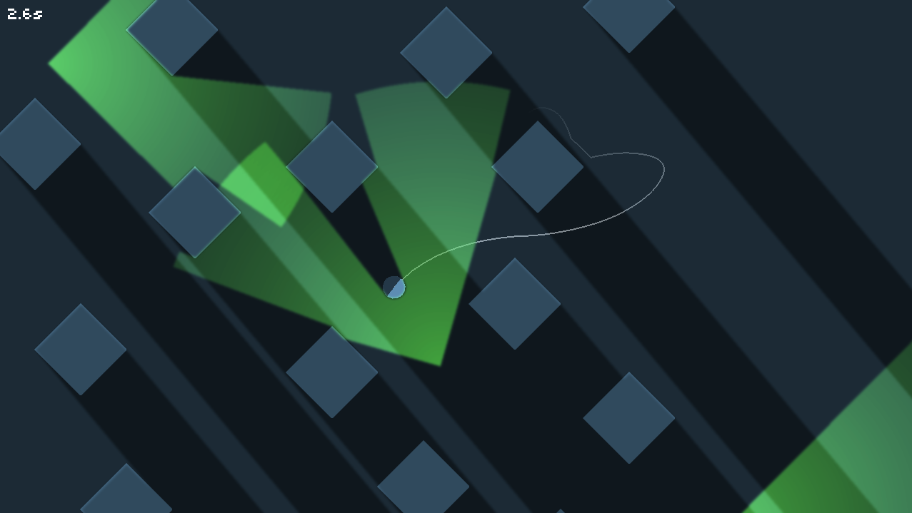

# Gravity Spy

A game made for Ludum Dare 27 recreated in Rust+Bevy with the help of AI.

Gravity Spy is a minimalist 2D platformer where gravity pulls toward the nearest surface.
Roll the spy across the environment and reach the goal without being seen by agents.



I've lost the source code and the game itself, except a couple of screenshots and video.
Using AI and my memory I can recreate the game fairly easily.
I've used Java with libGDX and Box2d originally.
It was a 48h game jam.
I remember really liking 2d shadows and how they ended up looking.

The main thing is obviously the gravity.
I remember first experiments, figuring out raycasting and gravity calculations, and if it would be possible to do some kind of "spatial distance partitioning mapping thing" of nearest surfaces for every pixel.
Like some sort of a "gravity map" (there's research work for similar problems).

Like, why don't I see something similar elsewhere? It's so cool.
I have ideas of bringing something like this to 3D, and have already tried.
I'll make time some day and do it.

## Play

Green cones are safe, yellow cones warn, and red cones detect you.
Hide behind terrain, which is the only thing that blocks vision.

| Key                 | Action                      |
| ------------------- | --------------------------- |
| A / D, Left / Right | Move along the surface      |
| Space, W, Up        | Jump                        |
| Space, Enter        | Start, confirm, next level  |
| Arrows              | Choose a menu item or level |
| P                   | Pause                       |
| R                   | Retry                       |
| Tab                 | Level selection             |
| M, + / -            | Mute, volume                |
| F1                  | Debug view                  |
| Esc                 | Main menu                   |

## Build and run

On Linux, the native build needs the ALSA, X11, and Vulkan development libraries.
`nix-shell` provides them.

```sh
nix-shell
just run
```

Other recipes:

```sh
just run --level level-3 --autostart  # jump straight into a level
just release                          # optimized build
just package                          # executable and assets in target/dist/gravity-spy
just test
```

### Web

The browser build needs [wasm-pack](https://github.com/drager/wasm-pack) and WebGL2:

```sh
rustup target add wasm32-unknown-unknown
just web    # builds target/web
just serve  # http://localhost:8000
```

The output uses relative paths, so it can be hosted from any directory, such as GitHub Pages.

The web version is available on https://tinrab.github.io/gravity-spy/.

## Levels

Levels are SVG files in `assets/levels`.
Start a new one from `assets/authoring/template.svg`.
Shapes in the `terrain` layer are solid.
Object IDs such as `spawn`, `goal`, `agent-*`, `patrol-*`, `crate-*`, and `light-*` define gameplay.

```sh
just edit path/to/level.svg                   # preview; F5 reloads after edits
just run --validate-level path/to/level.svg   # check without opening a window
```
